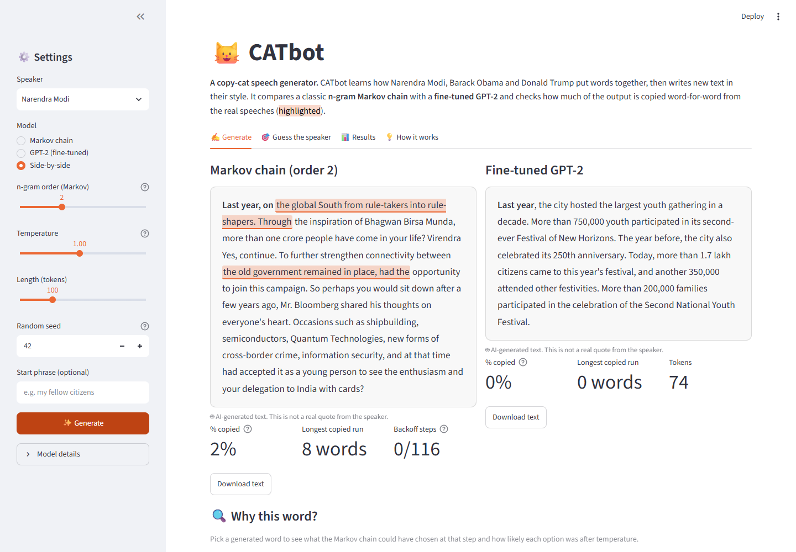
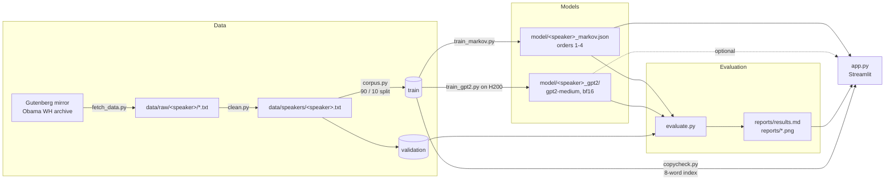
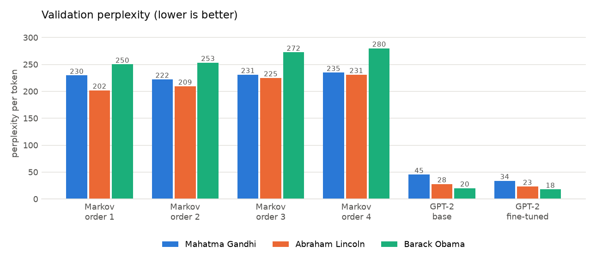
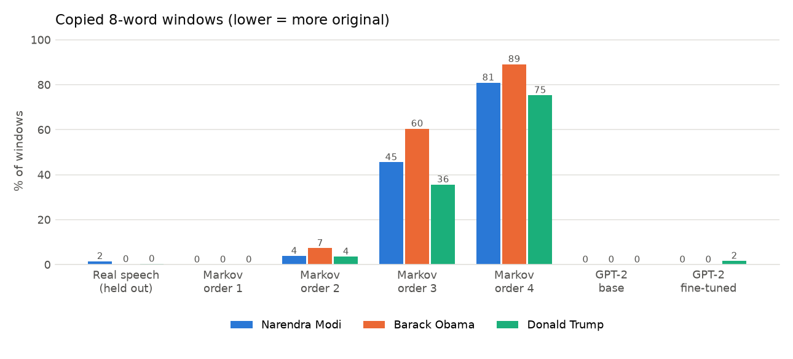
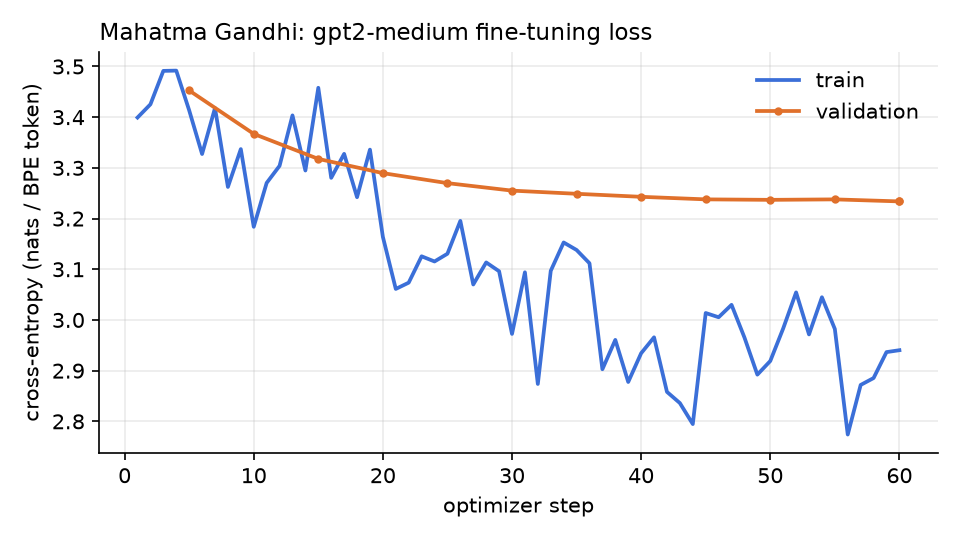
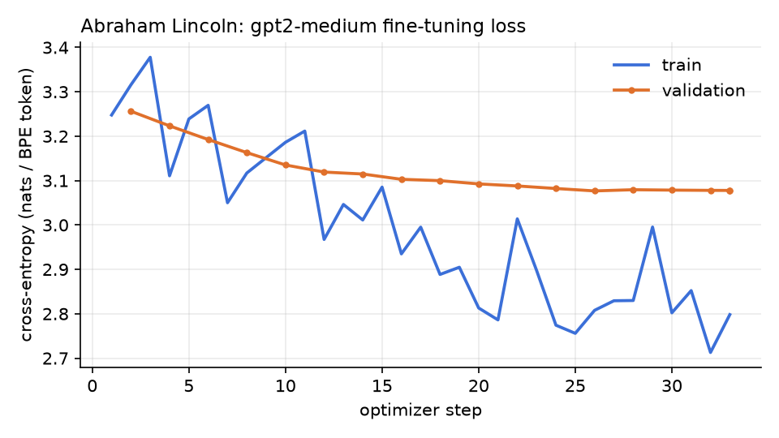
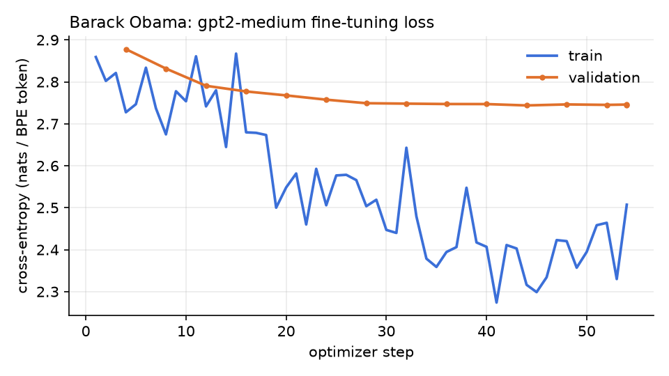
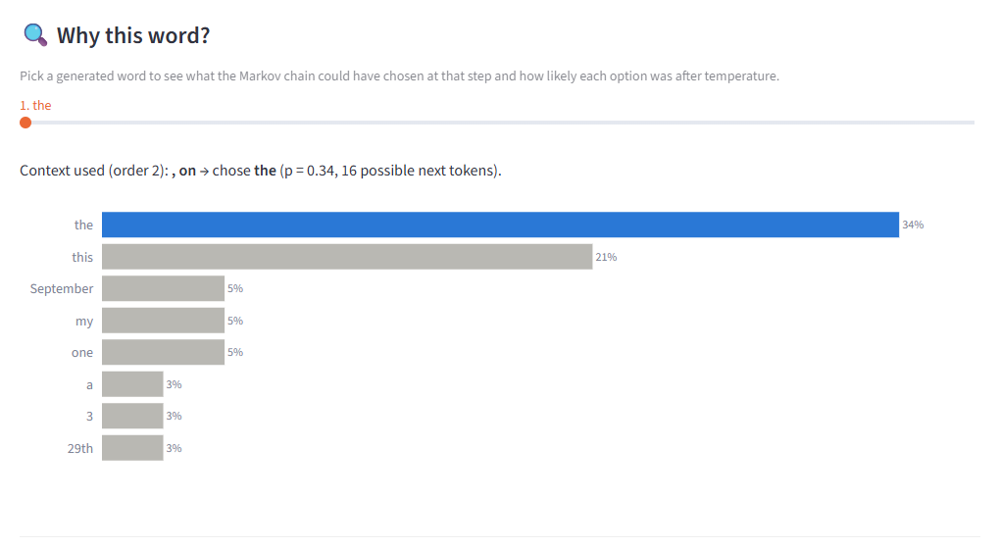
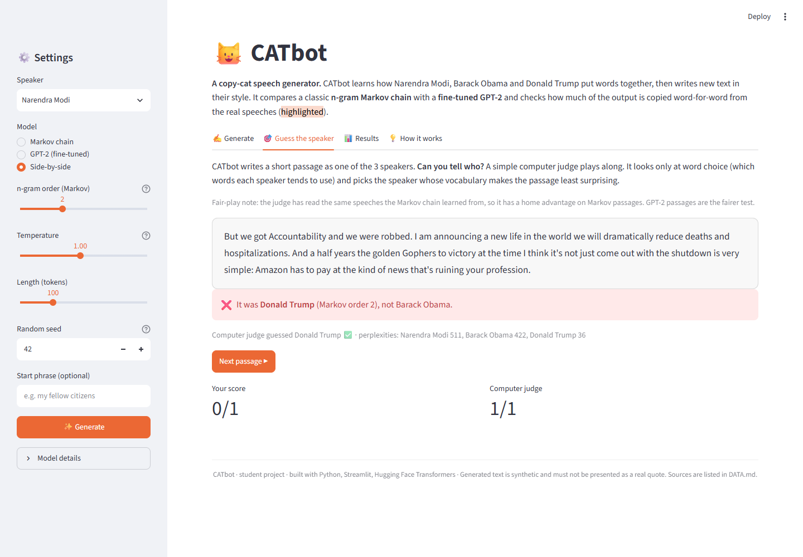
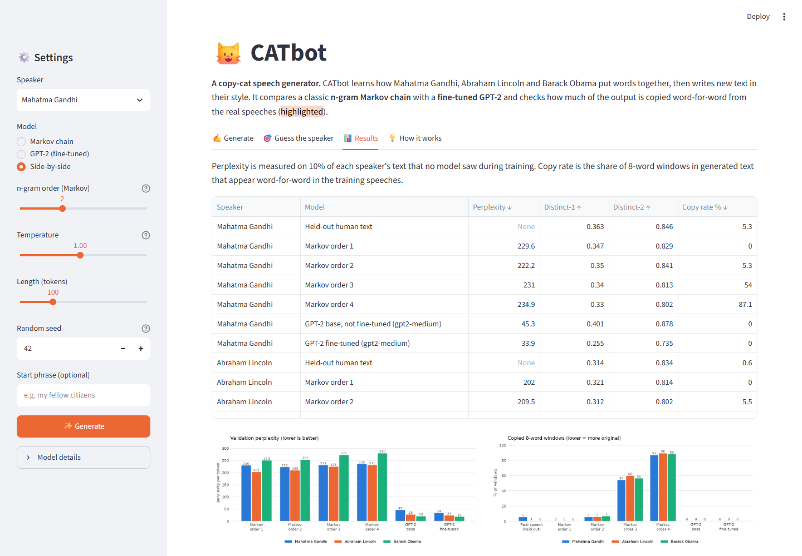

# 🐱 CATbot: a copy-cat speech generator

CATbot learns how **Mahatma Gandhi**, **Abraham Lincoln** and **Barack Obama** put words together, then writes new text in each person's style. It compares a classic **n-gram Markov chain** with a **fine-tuned GPT-2** and measures how much of what each model writes is new and how much is copied word for word from the real speeches.



> Generated text is synthetic. Never present it as a real quote from any of these people.

## The problem

A "copy-cat" text generator is easy to build and easy to fool yourself with. Output that sounds exactly like the speaker is often just the training text pasted back. This project asks three questions:

1. Can a simple statistical model capture a speaker's style?
2. How much better is a modern neural model?
3. **How much of each model's "style" is plain copying?**

## Approach

| Step | What happens | Code |
|---|---|---|
| Data | Public-domain speeches: 73.6k words of Gandhi, 39.9k of Lincoln, 67.1k of Obama ([sources](DATA.md)) | `fetch_data.py`, `clean.py` |
| Split | Every 10th 200-word chunk is held out (10%), identical for all models | `corpus.py` |
| Markov chain | Counts which word follows every 1-, 2-, 3- and 4-word context. Generates with **temperature** sampling, and **backs off** to a shorter context when a context was never seen. Witten-Bell smoothing gives a proper perplexity. | `model.py`, `train_markov.py` |
| GPT-2 | `gpt2-medium` (355M parameters) fine-tuned per speaker with the Hugging Face `Trainer`: bf16, 3 epochs, cosine LR, best checkpoint by validation loss, on an **NVIDIA H200** (about 2 minutes per speaker) | `train_gpt2.py`, `neural.py` |
| Evaluation | Perplexity on held-out text, distinct-1/2 diversity, 8-word **copy rate**, plus an un-fine-tuned GPT-2 baseline and the real held-out speech as a reference | `evaluate.py`, `copycheck.py` |
| App | Streamlit: generate, compare side by side, highlight copied phrases, explain every Markov step, guess-the-speaker game | `app.py` |

## Architecture



## Results

Measured on the 10% of each speaker's text that no model saw during training. Each model produced 20 samples of 150 tokens at temperature 1.0 (GPT-2 also used top-p 0.95), all from the same two-word prompts. Full table: [reports/results.md](reports/results.md).

| Speaker | Model | Perplexity ↓ | Distinct-2 ↑ | Copy rate ↓ |
|---|---|---:|---:|---:|
| Gandhi | Real speech (held out) | – | 0.846 | 5.3% |
| Gandhi | Markov, order 1 | 229.6 | 0.829 | 0.0% |
| Gandhi | Markov, order 2 | 222.2 | 0.841 | 5.3% |
| Gandhi | Markov, order 4 | 234.9 | 0.802 | **87.1%** |
| Gandhi | GPT-2, not fine-tuned | 45.3 | 0.878 | 0.0% |
| Gandhi | **GPT-2, fine-tuned** | **33.9** | 0.735 | 0.0% |
| Lincoln | Markov, order 2 | 209.5 | 0.802 | 5.5% |
| Lincoln | Markov, order 4 | 231.0 | 0.799 | **89.6%** |
| Lincoln | GPT-2, not fine-tuned | 28.0 | 0.870 | 0.0% |
| Lincoln | **GPT-2, fine-tuned** | **23.2** | 0.786 | 0.0% |
| Obama | Markov, order 2 | 253.4 | 0.867 | 6.5% |
| Obama | Markov, order 4 | 280.1 | 0.828 | **88.2%** |
| Obama | GPT-2, not fine-tuned | 20.2 | 0.876 | 0.0% |
| Obama | **GPT-2, fine-tuned** | **17.9** | 0.833 | 0.0% |

<p>
 
</p>

What the numbers show:

- **Higher Markov orders sound better because they copy.** At order 4, 87–90% of 8-word windows are lifted verbatim from the training speeches. Order 2 copies 5–7%, close to how often Gandhi repeats his own phrases (5.3%) though more than Lincoln or Obama do (under 1%). Order 2 is the default for that reason.
- **Higher orders don't predict new text better.** With 40–70k words per speaker, most 3- and 4-word contexts in unseen text never appeared in training, so validation perplexity *rises* from order 2 to order 4.
- **Fine-tuned GPT-2 is about 6–14× better at predicting the speaker** (perplexity 18–34 vs 209–253), and it copies **0%**. Its pre-training on web text lets it generalise instead of memorise.
- **Fine-tuning works.** It lowers perplexity by 11–25% compared with the same model without fine-tuning. It also lowers distinct-2: the model narrows its vocabulary to the speaker's favourite words and phrases.
- **Each speaker's style is measurably distinct.** A speaker's own Markov model scores their held-out text 2.6–5× better than another speaker's model does (diagonal ≈ 210–250, off-diagonal 577–1107). The game's "computer judge" uses this to guess who wrote a passage.

| Markov model ↓ / held-out text → | Gandhi | Lincoln | Obama |
|---|---:|---:|---:|
| Gandhi | **222** | 577 | 1107 |
| Lincoln | 665 | **209** | 973 |
| Obama | 870 | 743 | **253** |

GPT-2 fine-tuning curves (validation loss decreases steadily with no overfitting after 3 epochs):

<p>
  
</p>

## The app

| | |
|---|---|
|  |  |
| **Why this word?** For each Markov step: the context it used, every candidate next word and its probability, and whether it had to back off. | **Guess the speaker.** You and a perplexity-based computer judge each guess who wrote the passage. |

- Sidebar: speaker, model (Markov / GPT-2 / side-by-side), n-gram order 1–4, temperature, length, seed, start phrase.
- Copied 8-word stretches are highlighted, with a **% copied** metric and the longest copied run.
- Results tab with the evaluation table and charts.



## How to run

```bash
git clone <this repo> && cd CATbot
python -m venv .venv
# Windows: .venv\Scripts\activate     macOS/Linux: source .venv/bin/activate
pip install -r requirements.txt
streamlit run app.py
```

That is enough for the full app in **Markov mode**: trained Markov models (`model/*_markov.json`) and the evaluation reports are committed. If the JSON files are missing, the app trains the Markov chains from `data/speakers/` on startup in about a second.

### Optional: GPT-2 mode

The GPT-2 weights (about 680 MB per speaker) are **not** in git. To enable GPT-2 and side-by-side mode, either copy `model/<speaker>_gpt2/` folders into `model/`, or train them yourself:

```bash
pip install -r requirements-gpu.txt     # install the CUDA build of torch for your GPU first
python train_gpt2.py                    # all speakers, gpt2-medium (≈2 min each on an H200)
python train_gpt2.py --base distilgpt2 --batch 4   # smaller GPU / quick test
```

### Rebuild everything from scratch

```bash
python fetch_data.py      # download the public-domain speeches
python clean.py           # -> data/speakers/<speaker>.txt
python train_markov.py    # -> model/<speaker>_markov.json
python train_gpt2.py      # -> model/<speaker>_gpt2/ (GPU)
python evaluate.py        # -> reports/  (add --no-gpt2 to skip GPT-2)
python generate.py --speaker lincoln --order 2 --temperature 0.8 --seed 7   # command-line generation
python -m pytest -q       # tests
```

### Deploy to Streamlit Community Cloud

1. Push this repo to GitHub.
2. On [share.streamlit.io](https://share.streamlit.io) choose **New app**, pick the repo, branch `main`, main file `app.py`, and Python 3.12 or newer.
3. Done. `requirements.txt` holds only the light app dependencies, so the cloud app runs in Markov mode. The GPT-2 weights are too large for the free tier.

## Project layout

```
app.py            Streamlit app
model.py          n-gram Markov model (orders 1-4, temperature, backoff, Witten-Bell perplexity)
copycheck.py      copy rate, copied-token mask, distinct-n
corpus.py         speaker list + shared 90/10 split
neural.py         optional GPT-2 helpers (lazy torch import)
fetch_data.py     download sources      clean.py     clean + merge per speaker
train_markov.py   train Markov models   train_gpt2.py  fine-tune GPT-2
evaluate.py       metrics, tables, charts  generate.py  CLI generator
data/             raw + cleaned speeches (DATA.md has sources)
model/            *_markov.json (committed), *_gpt2/ (gitignored)
reports/          results.md, results.json, charts, loss curves
tests/            pytest: cleaning, model, copy-check, app smoke test
```

## Limitations

- **Small data.** 40–74k words per speaker is tiny for language modelling. It is the main reason high-order Markov chains copy.
- **Markov chains have no meaning.** They track only the last few words, so the text drifts between topics and sometimes isn't grammatical.
- **GPT-2 brings outside knowledge.** It can produce fluent text with facts, names or opinions the speaker never expressed. That makes its output *more* misleading as a "quote", not less.
- **Copy rate is a lower bound.** It only catches exact 8-word matches. Close paraphrases are not counted.
- **Perplexity comparison.** Both models are scored per word/punctuation token on the same text, but the Markov model ignores case and GPT-2 does not. That makes GPT-2's task slightly harder.
- **Source noise.** Gandhi's book quotes a few letters by other people in full. The Obama transcripts are of delivered speeches, including ad-libs.
- **Speaker choice.** APJ Abdul Kalam was the original third speaker, but his speeches are still under copyright. See [DATA.md](DATA.md).

## Future work

- Add more speakers and more text per speaker, and use the 1950s+ speeches of Indian leaders once their copyright allows it.
- Kneser-Ney smoothing and a tuned interpolation for the n-gram model.
- Parameter-efficient fine-tuning (LoRA) of a larger model, and a copy penalty during decoding.
- A human evaluation: can classmates tell real held-out paragraphs from generated ones?
- Stylometric features (sentence length, function-word profile) as a stronger "computer judge".

## Credits

Source texts: Project Gutenberg and the Obama White House archive (public domain; details in [DATA.md](DATA.md)). Built with Python, Streamlit, Plotly, Matplotlib, PyTorch and Hugging Face Transformers. Older Colab notebooks from the first version of the project are kept in `CATbot_Colab_Train.ipynb` and `copycat_bot_colab.ipynb`. They export the old single-speaker format and are not used by the current app.
# manvi

