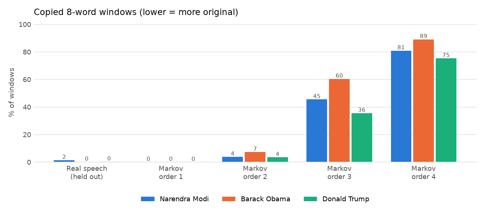

# CATbot evaluation results

Validation = 10% held-out text per speaker. 20 samples x 150 tokens per model, temperature 1.0 (GPT-2: top-p 0.95), same two-word prompts for every model.

| Speaker | Model | Perplexity ↓ | Distinct-1 ↑ | Distinct-2 ↑ | Copy rate (8-word) ↓ |
|---|---|---:|---:|---:|---:|
| Narendra Modi | Held-out human text | – | 0.359 | 0.827 | 1.5% |
| Narendra Modi | Markov order 1 | 171.0 | 0.386 | 0.875 | 0.0% |
| Narendra Modi | Markov order 2 | 160.4 | 0.384 | 0.848 | 3.8% |
| Narendra Modi | Markov order 3 | 172.7 | 0.383 | 0.870 | 45.5% |
| Narendra Modi | Markov order 4 | 181.4 | 0.371 | 0.862 | 80.9% |
| Barack Obama | Held-out human text | – | 0.367 | 0.867 | 0.2% |
| Barack Obama | Markov order 1 | 250.6 | 0.372 | 0.870 | 0.0% |
| Barack Obama | Markov order 2 | 254.5 | 0.384 | 0.871 | 7.3% |
| Barack Obama | Markov order 3 | 273.6 | 0.376 | 0.879 | 60.5% |
| Barack Obama | Markov order 4 | 281.2 | 0.358 | 0.860 | 89.2% |
| Donald Trump | Held-out human text | – | 0.309 | 0.807 | 0.3% |
| Donald Trump | Markov order 1 | 144.5 | 0.341 | 0.829 | 0.0% |
| Donald Trump | Markov order 2 | 139.7 | 0.345 | 0.846 | 3.5% |
| Donald Trump | Markov order 3 | 152.8 | 0.314 | 0.812 | 35.6% |
| Donald Trump | Markov order 4 | 160.3 | 0.336 | 0.822 | 75.4% |

Perplexity is per word/punctuation token for every model (GPT-2's total BPE log-loss is divided by the same token count), so the numbers are comparable. The *held-out human text* row is the speaker's real unseen speech. Its copy rate shows how often a person naturally repeats their own 8-word phrases.

## Cross-speaker perplexity (Markov order 2)

| model \ text | Narendra Modi | Barack Obama | Donald Trump |
|---|---:|---:|---:|
| Narendra Modi | 160 | 799 | 743 |
| Barack Obama | 835 | 254 | 400 |
| Donald Trump | 1111 | 648 | 140 |

