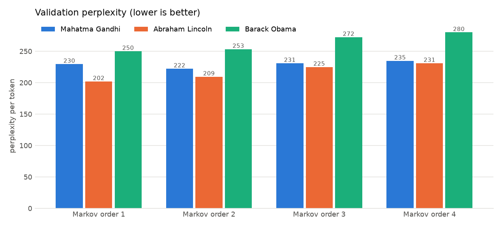
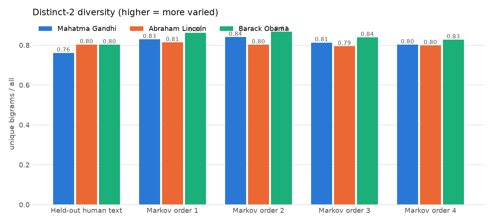
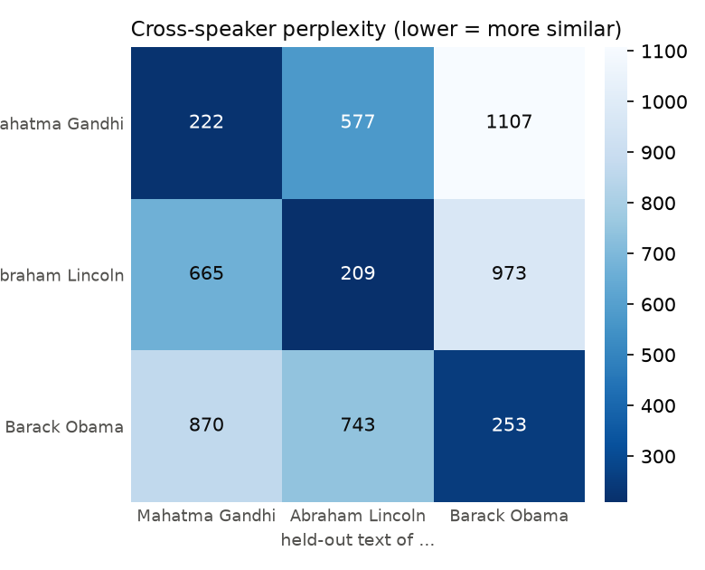

# CATbot evaluation results

Validation = 10% held-out text per speaker. 20 samples x 150 tokens per model, temperature 1.0 (GPT-2: top-p 0.95), same two-word prompts for every model.

| Speaker | Model | Perplexity ↓ | Distinct-1 ↑ | Distinct-2 ↑ | Copy rate (8-word) ↓ |
|---|---|---:|---:|---:|---:|
| Mahatma Gandhi | Held-out human text | – | 0.257 | 0.761 | 3.5% |
| Mahatma Gandhi | Markov order 1 | 229.6 | 0.347 | 0.829 | 0.0% |
| Mahatma Gandhi | Markov order 2 | 222.2 | 0.350 | 0.841 | 5.3% |
| Mahatma Gandhi | Markov order 3 | 231.0 | 0.340 | 0.813 | 54.0% |
| Mahatma Gandhi | Markov order 4 | 234.9 | 0.330 | 0.802 | 87.1% |
| Abraham Lincoln | Held-out human text | – | 0.268 | 0.803 | 0.4% |
| Abraham Lincoln | Markov order 1 | 202.0 | 0.321 | 0.814 | 0.0% |
| Abraham Lincoln | Markov order 2 | 209.5 | 0.312 | 0.802 | 5.5% |
| Abraham Lincoln | Markov order 3 | 225.0 | 0.325 | 0.795 | 59.9% |
| Abraham Lincoln | Markov order 4 | 231.0 | 0.314 | 0.799 | 89.6% |
| Barack Obama | Held-out human text | – | 0.275 | 0.802 | 0.5% |
| Barack Obama | Markov order 1 | 250.2 | 0.356 | 0.862 | 0.0% |
| Barack Obama | Markov order 2 | 253.4 | 0.374 | 0.867 | 6.5% |
| Barack Obama | Markov order 3 | 272.5 | 0.360 | 0.839 | 56.4% |
| Barack Obama | Markov order 4 | 280.1 | 0.354 | 0.828 | 88.2% |

Perplexity is per word/punctuation token for every model (GPT-2's total BPE log-loss is divided by the same token count), so the numbers are comparable. The *held-out human text* row is the speaker's real unseen speech. Its copy rate shows how often a person naturally repeats their own 8-word phrases.

## Cross-speaker perplexity (Markov order 2)

| model \ text | Mahatma Gandhi | Abraham Lincoln | Barack Obama |
|---|---:|---:|---:|
| Mahatma Gandhi | 222 | 577 | 1107 |
| Abraham Lincoln | 665 | 209 | 973 |
| Barack Obama | 870 | 743 | 253 |

